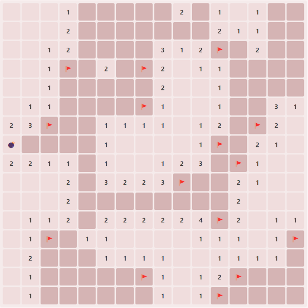

# Blitz Minesweeper

A real-time multiplayer minesweeper game inspired by blitz chess where players take turns revealing tiles under time pressure. Hitting a bomb incurs a large time penalty, run out and you're eliminated. Last player standing wins.



## Play

https://blitz-mine.onrender.com

## Development

```bash
# Install dependencies
yarn install

# Run dev server/client
yarn start:dev:client
yarn start:dev:server

# Production build
yarn build
yarn start
```

## TODO

- Handle single player
- Asks for player name
- Fix post-game menu
- Lobby options
- Lobby Menu
- Move queueing
- Animation when hitting bomb
- Add themes (light/dark mode)
- Add mute button
